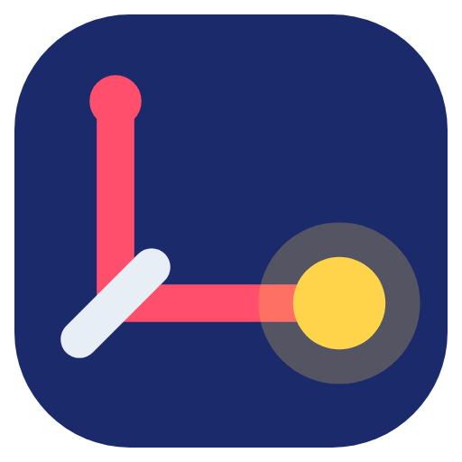

<p align="center"></p>

# LUMOS

**LUMOS** (Layout of Unruly Mirrors, Optics and Sources) is a program for designing laser setups on an optical table. You place lasers, lenses, mirrors, beamsplitters, wave plates, AOMs, fibres and detectors on a breadboard with holes exactly 25 mm apart, and LUMOS traces real Gaussian beams through them. It shows the beam size, power, polarisation and frequency shift at every part, works out fibre coupling efficiency, warns about damage thresholds and beams leaving the table, picks Thorlabs mounts and posts for your beam height, and turns the whole thing into a shopping list.

It runs on Windows, macOS and Linux as a desktop app, and in any modern web browser, including on a phone.

## Download

A ready-to-run Windows executable is on the [Releases](../../releases) page. It is a single `.exe` with everything built in, so there is nothing to install. Download it and double-click to run.

- **Windows:** `LUMOS-<version>.exe`. Windows SmartScreen may warn that the file is from an unknown publisher, because it is not code-signed. Click **More info**, then **Run anyway**.
- **macOS:** `LUMOS-<version>.dmg`. It is not notarised, so right-click the app and choose **Open** the first time.
- **Linux:** `LUMOS-<version>.AppImage`. Make it executable (`chmod +x`) and run it.

If GitHub Pages is switched on for this repository, LUMOS can also be used straight from the browser at `https://<your-username>.github.io/LUMOS/`.

Setups are saved on your computer and can be exported and opened as `.json` files, which you can share with others.

## Documentation

See the [user manual (PDF)](docs/LUMOS-user-manual.pdf) for a full guide to every part, tab and calculation.

## Building from source

See [INSTALL.md](INSTALL.md). In short, with [Node.js](https://nodejs.org) 20 or newer installed:

```
npm install
npm start          # run LUMOS in a window
npm run dist:win   # build dist/LUMOS-<version>.exe
```

Releases are built automatically by GitHub Actions: pushing a tag such as `v1.0.0` builds the Windows, macOS and Linux versions and attaches them to a new release (see `.github/workflows/release.yml`).

The program version is set in `package.json`. The whole app is the single file `app/index.html`, with its fonts in `app/fonts/`; `main.js` is the small desktop shell around it.

## Versioning

LUMOS uses [semantic versioning](https://semver.org). See [CHANGES.md](CHANGES.md) for what changed in each version.

## Licence

LUMOS is free software under the MIT licence. See [LICENSE](LICENSE).

- LUMOS © 2026 Adarsh.
- The bundled fonts (Barlow, Barlow Semi Condensed, Bevan, Nosifer and Press Start 2P) are used under the SIL Open Font License 1.1. Their licences are in `app/fonts/`.
- The desktop app is built with [Electron](https://www.electronjs.org) (MIT licence).
- Part numbers, specifications and damage thresholds are taken from public catalogues of Thorlabs, Gooch & Housego and Isomet, or are typical values, and are given for convenience only. LUMOS is not affiliated with any supplier. Always check the supplier's datasheet before buying or switching a laser on.
